# Lubist docs hub

Every doc in every Lubist repo, with its status and when to read it. Everything below
**"Needs attention"** is generated from the docs' own headers — don't edit it by hand.

## How to use this

- **Find a doc:** scan the tables below, or search the workspace (`Ctrl+Shift+F`) for
  `status: open-incident`, `area: mobile`, `type: runbook`, a tag, etc. Every doc starts with
  the same header, so these searches work everywhere.
- **See how docs connect:** open the `salon.code-workspace` with the **Foam** extension and run
  **Foam: Show Graph**. Each doc ends with a *Related / Referenced by* footer; those links are
  the graph's edges. Clicking a node opens the doc.
- **The Mermaid map** below is a quick overview. Most previews (including GitHub) disable clicks
  inside Mermaid, so use the table links or the Foam graph to open docs.

## The doc header

```yaml
---
title: Coupons & discounts
area: backend          # cross-cutting | backend | web | mobile | partner | admin
type: reference        # guide | reference | runbook | plan | tracker | incident | generated
status: current        # current | planned | blocked | open-incident | resolved
updated: 2026-11-12
read_when: One sentence — the situation in which someone should open this doc.
related:               # workspace-relative paths; becomes the Related footer + graph edges
  - backend/docs/PAYMENT_FLOW_AUDIT.md
tags: [backend, reference, current, coupons]
---
```

## Rules that keep this useful

1. **A doc describes the code as it is now.** When the code changes, update the doc in the
   same commit, or delete the doc. History belongs in git, not in docs.
2. **No "done" trackers.** Trackers (`TECH_DEBT.md`, `BACKLOG.md`) list only open items —
   delete a line when it's done. When a plan ships, turn it into a reference doc.
3. **New doc → give it a header → run the script:**
   ```bash
   python scripts/build_docs_hub.py           # from backend/: rebuild hub + footers
   python scripts/build_docs_hub.py --check   # exit 1 if a header is invalid or anything is stale
   ```

<!-- BEGIN GENERATED: build_docs_hub.py -->

_36 docs. Regenerate with `python scripts/build_docs_hub.py`._

## Needs attention

| Status | Doc | Read when |
|---|---|---|
| 🔴 open incident | [Payment flow audit & open payment incident](PAYMENT_FLOW_AUDIT.md) | ANY payment work — service checkout, product orders, vendor registration fee, the Razorpay webhook — and to pick up the open "payment debited, no booking" incident. |
| ⛔ blocked | [Insylo AI WhatsApp API (vendor reference)](insyloai_api_docs.md) | Resuming the WhatsApp booking-notification integration. BLOCKED: messages are accepted (201) but Meta rejects delivery with error 131042 (WABA payment/billing) — the client must fix billing first. Third-party docs, not ours. |
| 🗓️ planned | [Push notifications — plan](NOTIFICATIONS_FEATURE_PLAN.md) | Starting push notifications (marketing or transactional), or the client asks about order/booking notifications. |

## Map

```mermaid
flowchart LR
  subgraph cross_cutting["Cross-cutting (all apps)"]
    backend_docs_API_PARITY_md["API parity report (generated)"]
    backend_docs_CLIENT_APPS_AND_VERSIONING_md["Client apps & versioning (force-update, Partner split)"]
    backend_docs_MANUAL_QA_CHECKLIST_md["Manual QA checklist"]
    backend_docs_PARTIAL_UPDATES_md["Partial updates (edit forms)"]
  end
  subgraph backend["Backend (FastAPI)"]
    backend_SETUP_md["Backend local setup"]
    backend_docs_BANNER_API_md["Home banner (carousel) API"]
    backend_docs_BLOG_md["Blog & SEO"]
    backend_docs_COUPONS_md["Coupons & discounts"]
    backend_docs_E2E_TESTING_md["Staging end-to-end flow tests"]
    backend_docs_FEATURE_FLAGS_md["Feature flags (entitlements)"]
    backend_docs_MIGRATION_SAFETY_md["Database migrations — workflow & safety"]
    backend_docs_NOTIFICATIONS_FEATURE_PLAN_md["Push notifications — plan"]
    backend_docs_OBSERVABILITY_md["Observability (Better Stack logs & uptime)"]
    backend_docs_PAYMENT_FLOW_AUDIT_md["Payment flow audit & open payment incident"]
    backend_docs_PRODUCT_FAVORITES_API_md["Product favorites API"]
    backend_docs_QUALITY_SYSTEM_md["Quality system (start here for testing)"]
    backend_docs_REGULAR_BUYER_WORKFLOW_md["Regular buyer (B2B) workflow"]
    backend_docs_RESEND_EMAIL_SETUP_md["Email via Resend (both channels)"]
    backend_docs_TECH_DEBT_md["Backend tech debt & open loose ends"]
    backend_docs_environment_keys_guide_md["Backend environment variables"]
    backend_docs_incidents_2026_09_21_admin_user_not_allowed_md["Incident: admin 'User not allowed' creating users"]
    backend_docs_incidents_2026_09_23_salon_id_500_md["Incident: malformed salon ID returned 500"]
    backend_docs_insyloai_api_docs_md["Insylo AI WhatsApp API (vendor reference)"]
    backend_docs_rate_limiting_guide_md["Rate limiting"]
    backend_docs_system_config_md["system_config keys"]
  end
  subgraph web["Web (Next.js)"]
    salon_management_next_README_md["Lubist Web — README"]
    salon_management_next_docs_ARCHITECTURE_md["Lubist Web — architecture & decisions"]
    salon_management_next_docs_BACKLOG_md["Lubist Web — open work"]
    salon_management_next_docs_CONVENTIONS_md["Lubist Web — coding conventions"]
    salon_management_next_docs_PERFORMANCE_PLAN_md["Lubist Web — performance plan"]
  end
  subgraph mobile["Customer app (Expo)"]
    lubist_mobile_application_README_md["Lubist customer app — README"]
    lubist_mobile_application_docs_API_CONTRACT_md["Customer app — API contract, client headers, force-update"]
    lubist_mobile_application_docs_RELEASING_md["Releasing the customer app (OTA, builds, Play Store)"]
  end
  subgraph partner["Partner app (Expo)"]
    lubist_vendor_application_README_md["Lubist Partner (vendor app) — README"]
    lubist_vendor_application_docs_API_CONTRACT_md["Partner app — API contract, client headers, force-update"]
  end
  backend_SETUP_md --- backend_docs_environment_keys_guide_md
  backend_SETUP_md --- backend_docs_MIGRATION_SAFETY_md
  backend_SETUP_md --- backend_docs_QUALITY_SYSTEM_md
  backend_docs_API_PARITY_md --- backend_docs_QUALITY_SYSTEM_md
  backend_docs_API_PARITY_md --- lubist_mobile_application_docs_API_CONTRACT_md
  backend_docs_API_PARITY_md --- lubist_vendor_application_docs_API_CONTRACT_md
  backend_docs_BANNER_API_md --- backend_docs_BLOG_md
  backend_docs_BLOG_md --- backend_docs_FEATURE_FLAGS_md
  backend_docs_BLOG_md --- salon_management_next_docs_ARCHITECTURE_md
  backend_docs_CLIENT_APPS_AND_VERSIONING_md --- backend_docs_system_config_md
  backend_docs_CLIENT_APPS_AND_VERSIONING_md --- backend_docs_MIGRATION_SAFETY_md
  backend_docs_CLIENT_APPS_AND_VERSIONING_md --- backend_docs_REGULAR_BUYER_WORKFLOW_md
  backend_docs_CLIENT_APPS_AND_VERSIONING_md --- lubist_mobile_application_docs_API_CONTRACT_md
  backend_docs_CLIENT_APPS_AND_VERSIONING_md --- lubist_vendor_application_docs_API_CONTRACT_md
  backend_docs_CLIENT_APPS_AND_VERSIONING_md --- lubist_mobile_application_docs_RELEASING_md
  backend_docs_COUPONS_md --- backend_docs_PAYMENT_FLOW_AUDIT_md
  backend_docs_COUPONS_md --- backend_docs_PARTIAL_UPDATES_md
  backend_docs_API_PARITY_md --- backend_docs_COUPONS_md
  backend_docs_E2E_TESTING_md --- backend_docs_QUALITY_SYSTEM_md
  backend_docs_E2E_TESTING_md --- backend_docs_MANUAL_QA_CHECKLIST_md
  backend_docs_E2E_TESTING_md --- backend_docs_REGULAR_BUYER_WORKFLOW_md
  backend_docs_MANUAL_QA_CHECKLIST_md --- backend_docs_QUALITY_SYSTEM_md
  backend_docs_MANUAL_QA_CHECKLIST_md --- lubist_mobile_application_docs_RELEASING_md
  backend_docs_MIGRATION_SAFETY_md --- backend_docs_QUALITY_SYSTEM_md
  backend_docs_MIGRATION_SAFETY_md --- backend_docs_NOTIFICATIONS_FEATURE_PLAN_md
  backend_docs_BANNER_API_md --- backend_docs_NOTIFICATIONS_FEATURE_PLAN_md
  backend_docs_NOTIFICATIONS_FEATURE_PLAN_md --- lubist_vendor_application_README_md
  backend_docs_OBSERVABILITY_md --- backend_docs_incidents_2026_09_23_salon_id_500_md
  backend_docs_OBSERVABILITY_md --- backend_docs_PAYMENT_FLOW_AUDIT_md
  backend_docs_OBSERVABILITY_md --- backend_docs_TECH_DEBT_md
  backend_docs_PARTIAL_UPDATES_md --- salon_management_next_docs_CONVENTIONS_md
  backend_docs_PAYMENT_FLOW_AUDIT_md --- backend_docs_system_config_md
  backend_docs_PAYMENT_FLOW_AUDIT_md --- backend_docs_TECH_DEBT_md
  backend_docs_API_PARITY_md --- backend_docs_PRODUCT_FAVORITES_API_md
  backend_docs_CLIENT_APPS_AND_VERSIONING_md --- backend_docs_QUALITY_SYSTEM_md
  backend_docs_QUALITY_SYSTEM_md --- lubist_mobile_application_docs_API_CONTRACT_md
  backend_docs_REGULAR_BUYER_WORKFLOW_md --- backend_docs_system_config_md
  backend_docs_COUPONS_md --- backend_docs_REGULAR_BUYER_WORKFLOW_md
  backend_docs_RESEND_EMAIL_SETUP_md --- backend_docs_environment_keys_guide_md
  backend_docs_COUPONS_md --- backend_docs_TECH_DEBT_md
  backend_docs_TECH_DEBT_md --- backend_docs_rate_limiting_guide_md
  backend_docs_TECH_DEBT_md --- salon_management_next_docs_BACKLOG_md
  backend_docs_environment_keys_guide_md --- backend_docs_system_config_md
  backend_docs_CLIENT_APPS_AND_VERSIONING_md --- backend_docs_environment_keys_guide_md
  backend_docs_TECH_DEBT_md --- backend_docs_incidents_2026_09_21_admin_user_not_allowed_md
  backend_docs_NOTIFICATIONS_FEATURE_PLAN_md --- backend_docs_insyloai_api_docs_md
  backend_docs_E2E_TESTING_md --- backend_docs_rate_limiting_guide_md
  lubist_mobile_application_README_md --- lubist_mobile_application_docs_RELEASING_md
  lubist_mobile_application_README_md --- lubist_mobile_application_docs_API_CONTRACT_md
  lubist_mobile_application_README_md --- lubist_vendor_application_README_md
  backend_docs_API_PARITY_md --- lubist_mobile_application_README_md
  lubist_mobile_application_docs_API_CONTRACT_md --- lubist_vendor_application_docs_API_CONTRACT_md
  lubist_mobile_application_docs_API_CONTRACT_md --- lubist_mobile_application_docs_RELEASING_md
  lubist_mobile_application_docs_RELEASING_md --- lubist_vendor_application_README_md
  lubist_vendor_application_README_md --- lubist_vendor_application_docs_API_CONTRACT_md
  backend_docs_CLIENT_APPS_AND_VERSIONING_md --- lubist_vendor_application_README_md
  salon_management_next_README_md --- salon_management_next_docs_CONVENTIONS_md
  salon_management_next_README_md --- salon_management_next_docs_ARCHITECTURE_md
  salon_management_next_README_md --- salon_management_next_docs_BACKLOG_md
  backend_SETUP_md --- salon_management_next_README_md
  salon_management_next_docs_ARCHITECTURE_md --- salon_management_next_docs_CONVENTIONS_md
  salon_management_next_docs_ARCHITECTURE_md --- salon_management_next_docs_PERFORMANCE_PLAN_md
  salon_management_next_docs_ARCHITECTURE_md --- salon_management_next_docs_BACKLOG_md
  backend_docs_CLIENT_APPS_AND_VERSIONING_md --- salon_management_next_docs_ARCHITECTURE_md
  backend_docs_API_PARITY_md --- salon_management_next_docs_ARCHITECTURE_md
  salon_management_next_docs_BACKLOG_md --- salon_management_next_docs_PERFORMANCE_PLAN_md
  backend_docs_PRODUCT_FAVORITES_API_md --- salon_management_next_docs_BACKLOG_md
  backend_docs_MANUAL_QA_CHECKLIST_md --- salon_management_next_docs_BACKLOG_md
  backend_docs_FEATURE_FLAGS_md --- salon_management_next_docs_CONVENTIONS_md
  click backend_SETUP_md "../SETUP.md"
  click backend_docs_API_PARITY_md "API_PARITY.md"
  click backend_docs_BANNER_API_md "BANNER_API.md"
  click backend_docs_BLOG_md "BLOG.md"
  click backend_docs_CLIENT_APPS_AND_VERSIONING_md "CLIENT_APPS_AND_VERSIONING.md"
  click backend_docs_COUPONS_md "COUPONS.md"
  click backend_docs_E2E_TESTING_md "E2E_TESTING.md"
  click backend_docs_FEATURE_FLAGS_md "FEATURE_FLAGS.md"
  click backend_docs_MANUAL_QA_CHECKLIST_md "MANUAL_QA_CHECKLIST.md"
  click backend_docs_MIGRATION_SAFETY_md "MIGRATION_SAFETY.md"
  click backend_docs_NOTIFICATIONS_FEATURE_PLAN_md "NOTIFICATIONS_FEATURE_PLAN.md"
  click backend_docs_OBSERVABILITY_md "OBSERVABILITY.md"
  click backend_docs_PARTIAL_UPDATES_md "PARTIAL_UPDATES.md"
  click backend_docs_PAYMENT_FLOW_AUDIT_md "PAYMENT_FLOW_AUDIT.md"
  click backend_docs_PRODUCT_FAVORITES_API_md "PRODUCT_FAVORITES_API.md"
  click backend_docs_QUALITY_SYSTEM_md "QUALITY_SYSTEM.md"
  click backend_docs_REGULAR_BUYER_WORKFLOW_md "REGULAR_BUYER_WORKFLOW.md"
  click backend_docs_RESEND_EMAIL_SETUP_md "RESEND_EMAIL_SETUP.md"
  click backend_docs_TECH_DEBT_md "TECH_DEBT.md"
  click backend_docs_environment_keys_guide_md "environment-keys-guide.md"
  click backend_docs_incidents_2026_09_21_admin_user_not_allowed_md "incidents/2026-09-21_admin_user_not_allowed.md"
  click backend_docs_incidents_2026_09_23_salon_id_500_md "incidents/2026-09-23_salon_id_500.md"
  click backend_docs_insyloai_api_docs_md "insyloai_api_docs.md"
  click backend_docs_rate_limiting_guide_md "rate-limiting-guide.md"
  click backend_docs_system_config_md "system_config.md"
  click lubist_mobile_application_README_md "../../lubist_mobile_application/README.md"
  click lubist_mobile_application_docs_API_CONTRACT_md "../../lubist_mobile_application/docs/API_CONTRACT.md"
  click lubist_mobile_application_docs_RELEASING_md "../../lubist_mobile_application/docs/RELEASING.md"
  click lubist_vendor_application_README_md "../../lubist_vendor_application/README.md"
  click lubist_vendor_application_docs_API_CONTRACT_md "../../lubist_vendor_application/docs/API_CONTRACT.md"
  click salon_management_next_README_md "../../salon_management_next/README.md"
  click salon_management_next_docs_ARCHITECTURE_md "../../salon_management_next/docs/ARCHITECTURE.md"
  click salon_management_next_docs_BACKLOG_md "../../salon_management_next/docs/BACKLOG.md"
  click salon_management_next_docs_CONVENTIONS_md "../../salon_management_next/docs/CONVENTIONS.md"
  click salon_management_next_docs_PERFORMANCE_PLAN_md "../../salon_management_next/docs/PERFORMANCE_PLAN.md"
  classDef open fill:#fde2e1,stroke:#c0392b,color:#000
  classDef blocked fill:#fdebd0,stroke:#b9770e,color:#000
  classDef planned fill:#e8eaf6,stroke:#5c6bc0,color:#000
  classDef resolved fill:#eeeeee,stroke:#999,color:#555
  class backend_docs_PAYMENT_FLOW_AUDIT_md open
  class backend_docs_insyloai_api_docs_md blocked
  class backend_docs_NOTIFICATIONS_FEATURE_PLAN_md planned
  class backend_docs_incidents_2026_09_21_admin_user_not_allowed_md,backend_docs_incidents_2026_09_23_salon_id_500_md resolved
```



## Cross-cutting (all apps)

| Doc | Type | Status | Read when |
|---|---|---|---|
| [API parity report (generated)](API_PARITY.md) | generated | ✅ current | Checking which client (web, admin, customer app, Partner app) calls which endpoint, finding stale client calls before a release, or spotting a client that has fallen behind. |
| [Client apps & versioning (force-update, Partner split)](CLIENT_APPS_AND_VERSIONING.md) | reference | ✅ current | Shipping a mobile build, forcing users to update, moving vendors to the Partner app, or changing an API response that old app builds still read. |
| [Partial updates (edit forms)](PARTIAL_UPDATES.md) | reference | ✅ current | Writing or debugging any edit form / PUT-PATCH schema — blank vs null vs missing, and the 422 that names the field. |
| [Manual QA checklist](MANUAL_QA_CHECKLIST.md) | runbook | ✅ current | Before a release — the human-only checks (UI, real email, Razorpay screens, OTP, mobile apps) the E2E suite can't do. |

## Backend (FastAPI)

| Doc | Type | Status | Read when |
|---|---|---|---|
| [Backend local setup](../SETUP.md) | guide | ✅ current | Setting up the backend on a new machine, or coming back after a break and nothing starts. |
| [Quality system (start here for testing)](QUALITY_SYSTEM.md) | guide | ✅ current | Before a release, when you're unsure whether flows still work, or to understand how E2E, the API contract and the parity report fit together. |
| [Incident: admin "User not allowed" creating users](incidents/2026-09-21_admin_user_not_allowed.md) | incident | ☑️ resolved | Admin user creation (RM / customer) fails with GoTrue "User not allowed" (403), or before bumping supabase-py off 2.0.3. |
| [Incident: malformed salon ID returned 500](incidents/2026-09-23_salon_id_500.md) | incident | ☑️ resolved | A path ID that isn't a UUID (or a bad enum value) causes a 500, or you're adding a new route with an ID / enum path parameter. |
| [Payment flow audit & open payment incident](PAYMENT_FLOW_AUDIT.md) | incident | 🔴 open incident | ANY payment work — service checkout, product orders, vendor registration fee, the Razorpay webhook — and to pick up the open "payment debited, no booking" incident. |
| [Push notifications — plan](NOTIFICATIONS_FEATURE_PLAN.md) | plan | 🗓️ planned | Starting push notifications (marketing or transactional), or the client asks about order/booking notifications. |
| [Backend environment variables](environment-keys-guide.md) | reference | ✅ current | Setting up a new environment (local, staging, prod), a deploy fails at startup with a missing setting, or you need to know whether a value belongs in env or in system_config. |
| [Blog & SEO](BLOG.md) | reference | ✅ current | Touching the blog — posts, FAQs, the admin editor, the public /blog pages, the sitemap — or handing the blog over to the client. |
| [Coupons & discounts](COUPONS.md) | reference | ✅ current | Building or debugging anything coupon-related — admin/vendor coupon CRUD, applying a code at checkout (services or products), the "available offers" lists, or why a discount did/didn't apply. |
| [Home banner (carousel) API](BANNER_API.md) | reference | ✅ current | Changing the home-screen hero carousel — admin banner management, the public banner feed, or how web/mobile render it. |
| [Insylo AI WhatsApp API (vendor reference)](insyloai_api_docs.md) | reference | ⛔ blocked | Resuming the WhatsApp booking-notification integration. BLOCKED: messages are accepted (201) but Meta rejects delivery with error 131042 (WABA payment/billing) — the client must fix billing first. Third-party docs, not ours. |
| [Product favorites API](PRODUCT_FAVORITES_API.md) | reference | ✅ current | Working on saved/wishlist products — the mobile Saved tab, or adding product favorites to the website (not built there yet). |
| [Rate limiting](rate-limiting-guide.md) | reference | ✅ current | A client or test gets 429s, scripted logins start failing, or you're adding a sensitive endpoint that needs a limit. |
| [Regular buyer (B2B) workflow](REGULAR_BUYER_WORKFLOW.md) | reference | ✅ current | Anything about the regular_buyer role — RM intake, admin approval, how the buyer logs in, the registration fee, wholesale (B2B) prices, or a buyer who can't order. |
| [system_config keys](system_config.md) | reference | ✅ current | Changing a fee, Razorpay keys, booking rules, RM scoring or app version policy — or a payment fails because a key is missing on a fresh environment. |
| [Database migrations — workflow & safety](MIGRATION_SAFETY.md) | runbook | ✅ current | Before writing ANY schema change, before `supabase db push`, or when local and remote migration history disagree. |
| [Email via Resend (both channels)](RESEND_EMAIL_SETUP.md) | runbook | ✅ current | Emails aren't arriving, setting up email on a new environment, or editing the Supabase auth email templates. |
| [Feature flags (entitlements)](FEATURE_FLAGS.md) | runbook | ✅ current | Shipping a feature to prod before the client pays for it, handing a feature over, or marking an account as internal staff. |
| [Observability (Better Stack logs & uptime)](OBSERVABILITY.md) | runbook | ✅ current | Investigating a production error, querying logs, or checking uptime alerts. Logs are kept only 3 days. |
| [Staging end-to-end flow tests](E2E_TESTING.md) | runbook | ✅ current | Running or extending the staging E2E suite (scripts/run_e2e.py), or reading an E2E report. |
| [Backend tech debt & open loose ends](TECH_DEBT.md) | tracker | ✅ current | Looking for something small to clean up, or before starting an audit — so you don't re-discover what is already known. |

## Web (Next.js)

| Doc | Type | Status | Read when |
|---|---|---|---|
| [Lubist Web — coding conventions](../../salon_management_next/docs/CONVENTIONS.md) | guide | ✅ current | Before writing code in the Next app — structure and size rules, data fetching, auth, errors, styling, quality gates, cross-repo landmines. |
| [Lubist Web — README](../../salon_management_next/README.md) | guide | ✅ current | Setting up or running the Next.js web app, env vars, scripts, or finding the web docs. |
| [Lubist Web — performance plan](../../salon_management_next/docs/PERFORMANCE_PLAN.md) | plan | ✅ current | The site feels slow, clicks seem dead, TTFB work, or you're touching loading.tsx / route progress / navigation pending states (P1 explains why they exist). |
| [Lubist Web — architecture & decisions](../../salon_management_next/docs/ARCHITECTURE.md) | reference | ✅ current | Before structural work in the Next app — data fetching, auth/session, routing, URLs, redirects — or when something odd looks like a bug (check "Deliberate quirks" first). |
| [Lubist Web — open work](../../salon_management_next/docs/BACKLOG.md) | tracker | ✅ current | Picking the next web task, or before a release — the one list of everything known and not yet done in the Next app. |

## Customer app (Expo)

| Doc | Type | Status | Read when |
|---|---|---|---|
| [Lubist customer app — README](../../lubist_mobile_application/README.md) | guide | ✅ current | Setting up or running the customer mobile app, finding your way around its code, or finding the mobile docs. |
| [Customer app — API contract, client headers, force-update](../../lubist_mobile_application/docs/API_CONTRACT.md) | reference | ✅ current | Regenerating API types after a backend change, a type error after `npm run api:types`, the force-update / wrong-app screens, or client-identification headers. |
| [Releasing the customer app (OTA, builds, Play Store)](../../lubist_mobile_application/docs/RELEASING.md) | runbook | ✅ current | Shipping any customer-app change — deciding OTA vs new build, building for Play, bumping versions, testing on the preview lane, or rolling back. |

## Partner app (Expo)

| Doc | Type | Status | Read when |
|---|---|---|---|
| [Lubist Partner (vendor app) — README](../../lubist_vendor_application/README.md) | guide | ✅ current | Working on the vendor (salon-owner) mobile app — setup, first-build prerequisites, code map, gotchas. |
| [Partner app — API contract, client headers, force-update](../../lubist_vendor_application/docs/API_CONTRACT.md) | reference | ✅ current | Regenerating the Partner app's API types, its force-update / customer-account redirect, or its client-identification headers. |

<!-- END GENERATED: build_docs_hub.py -->

<!-- BEGIN RELATED: generated by backend/scripts/build_docs_hub.py from the header's `related:` -->

---

**Related:** [Backend local setup](../SETUP.md) · [Quality system (start here for testing)](QUALITY_SYSTEM.md) · [Backend tech debt & open loose ends](TECH_DEBT.md) · [Lubist Web — open work](../../salon_management_next/docs/BACKLOG.md)

<!-- END RELATED -->
